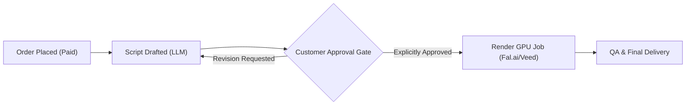

# Commercial AI Media Governance & Development Runbook

This skill packages the operational procedures, regulatory standards (UK GDPR, EU AI Act, PECR), and technical patterns established in the DoppelAI platform into a reusable blueprint for building and scaling commercial generative media applications.

---

## 1. Regulatory & Compliance Baseline

When developing features for platforms processing user portraits, voice, or synthetic media:

### A. Biometric & Likeness Data (UK GDPR Art. 9 & EU AI Act)
1. **Explicit Affirmative Consent**: Never assume implied consent. Unbundle consent for terms of service from consent for biometric avatar synthesis.
2. **Audit Trail Logging**: Persist immutable records of consent:
   * `consent_terms: bool`
   * `consent_likeness: bool`
   * `consent_timestamp: ISO-8601 UTC string`
   * Associated authenticated user ID / session ID.
3. **Data Retention & Shredding**:
   * Enforce a hard deletion schedule (default: 30 days post-fulfillment for source portrait photos).
   * Provide a functional GDPR Article 17 "Right to Erasure" workflow that scrubs local/cloud object storage and anonymizes financial records.

### B. Consumer Rights & Bespoke Goods (UK Consumer Rights Act 2015)
1. Video production based on custom photos and briefs constitutes **bespoke custom goods**.
2. **The Approval Boundary**: Full refunds are permitted prior to script approval. Once the client approves the script and synthesis commences, cooling-off cancellation rights are waived, except for technical rendering defects.

---

## 2. Technical Architecture & Money-Safety Patterns

### A. Human-in-the-Loop Oversight Gate

* **Invariant**: Never invoke GPU rendering models or billable synthesis endpoints without affirmative customer approval of the generated script.

### B. Fail-Closed & Idempotent External Billing
* **Payment Provenance Validation**: Verify that the payment intent has a status of `paid` from a verified payment provider (e.g. Stripe webhook HMAC) before scheduling billable background work.
* **Single-Submit Invariant**:
  1. Atomically claim the job state (`submitting`) before calling the provider API.
  2. Persist the provider request ID (`video_request_id`) immediately upon dispatch.
  3. Ambient network errors or timeouts must transition the job to `failed` for human review—**never** blindly auto-retry a potentially billed GPU request.
* **Resumption & Polling**: Polling existing jobs (`video_request_id`) is non-billable and safe to resume across server restarts.

---

## 3. Standard Operating Procedures Index

Refer to the complete operating procedures under `docs/sop/`:
* **[SOP-001: Commercial Order Fulfillment](./docs/sop/SOP-001_ORDER_FULFILLMENT.md)**: Asset acceptance criteria, script constraints (130-150 words for 60s), multi-format cuts (9:16, 1:1, 16:9), and QA lip-sync checklist.
* **[SOP-002: Biometric Data Governance & Privacy](./docs/sop/SOP-002_DATA_GOVERNANCE_AND_BIOMETRICS.md)**: Retention timelines, encryption at rest/in transit, and right-to-erasure runbook.
* **[SOP-003: Acceptable Use & AI Safety](./docs/sop/SOP-003_ACCEPTABLE_USE_AND_AI_SAFETY.md)**: Screening for celebrity likeness, fraud, hate speech, and C2PA synthetic media metadata disclosure.
* **[SOP-004: Customer Support, Revisions & Refunds](./docs/sop/SOP-004_CUSTOMER_SUPPORT_AND_REFUNDS.md)**: Response SLAs, revision protocols, and cooling-off cancellation handling.
* **[SOP-005: Security Incident Response](./docs/sop/SOP-005_INCIDENT_RESPONSE.md)**: Severity classification P1–P4, containment, and 72-hour ICO data breach reporting.

---

## 4. ISO Management Standards Alignment

Refer to **[ISO Alignment Framework](./docs/governance/ISO_ALIGNMENT.md)** for detailed controls:
* **ISO/IEC 42001:2023 (Artificial Intelligence Management System)**:
  * Human-in-the-loop oversight.
  * Continuous vendor risk monitoring (Google Vertex, Fal.ai).
  * Algorithmic traceability and prompt versioning.
* **ISO/IEC 27001:2022 (Information Security Management System)**:
  * RBAC separation between customer and admin roles.
  * Rotating `HttpOnly; SameSite=Lax; Secure` session cookies.
  * File isolation preventing Insecure Direct Object References (IDOR).
* **ISO/IEC 27701:2019 (Privacy Information Management System)**:
  * Privacy-by-design, zero non-essential tracking cookies, granular consent logs.

